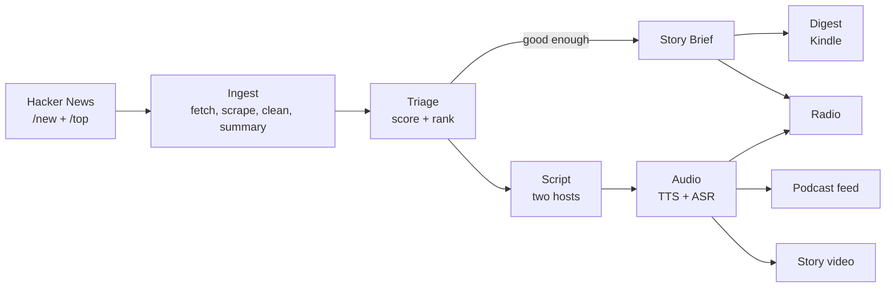
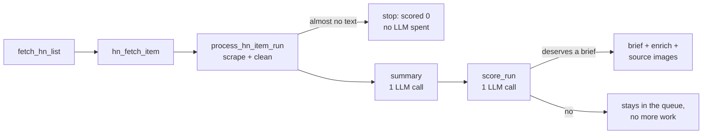
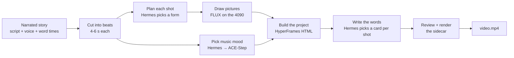
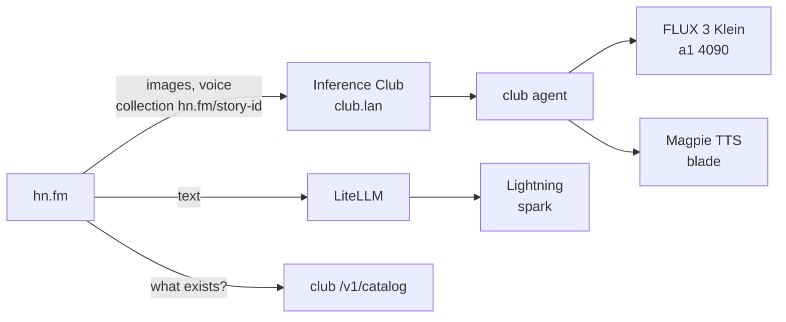
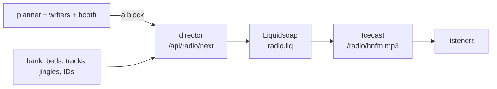

# How hn.fm works

A plain guide to what hn.fm does and where each part lives in the code.
Paths are relative to the repo root.

## The big picture

In short: hn.fm reads Hacker News, picks the stories worth your time, and turns them into things to read, hear and watch. Every model runs on the home cluster.

- **Reads HN all day.** It pulls `/new` and `/top` every 10 and 30 minutes, then scrapes each linked article.
- **Scores every story.** An LLM rates each one for *interest* and *producibility* (how much real material there is). Only the good ones get the expensive work.
- **Writes and voices scripts.** Two hosts (S1, S2) talk through a story. Magpie TTS speaks it and nemotron-asr writes word timings back.
- **Ships four products:** a Kindle digest (the main product right now), a podcast feed, a radio station, and story videos.
- **Runs on a timer.** Celery beat runs a schedule written in `config.yaml`. Two switches in the UI pause scraping or generation.
- **Local models only:** LLM = `nemotron-lightning` via LiteLLM, TTS = Magpie, ASR = nemotron-asr, images = FLUX 3 Klein (4090), music = ACE-Step. Story videos are directed by Hermes (its own `hnfm` profile).



- The digest and the radio write from the Story Brief. The script for podcasts and videos does not (see "From story to narration").
- Making a podcast or video is a manual step right now. The scheduled `produce-top-story` job is off (`enabled: false` in `config.yaml`, paused 2026-09-19).

## Getting stories in

In short: every new HN story is fetched, scraped and summarised cheaply. Then one LLM call scores it. Only stories that score well get more LLM calls spent on them.



**Fetching** (`src/hnfm/web/tasks.py`, `src/hnfm/utils/hn_utils.py`)
- `fetch_hn_list` gets the id list from the HN Firebase API. It takes the first 60 ids and queues any it has not seen.
- `hn_fetch_item` stores the item and records where it came from (`top` or `new`).
- Then it hands off to `process_hn_item_run`, if `TRIAGE_ON_INGEST=true` (it is on in the cluster).

**Scraping** (`src/hnfm/scraper/content_scraper.py`, `src/hnfm/scraper/source_handlers.py`, `src/hnfm/scraper/scrape_cache.py`)
- YouTube links: it reads the transcript. PDFs: it reads the text locally (up to 25 MB). Firecrawl can't handle either.
- Everything else goes to the in-cluster Firecrawl (`/v1/scrape`, markdown + links, main content only).
- If Firecrawl fails, it tries the Wayback Machine, but only for stories older than 24 hours. Archives under 500 characters are treated as error pages.
- Failed URLs are remembered for 6 hours so they aren't retried. Twitter/X is never tried.
- Ask HN / Show HN self-posts use their own HN text.
- If the scrape fails, it falls back to the HN title and text. That marks the story as a "fallback".

**Cleaning and the free gate** (`src/hnfm/utils/run_utils.py`, `src/hnfm/content/scrape_signals.py`)
- `clean_content` collapses whitespace.
- `scrape_signals.extract` measures what came back: characters, words, images, code, stub markers.
- `producibility_ceiling` caps the score based on that: fallback or stub → 15, under 400 chars → 20, under 1,200 → 45, under 2,500 → 70.
- If the cap is 20 or less, the story is saved as `unsuitable` with no LLM call at all (`_abandon_empty_run`). Why: a 43-character error page used to cost five LLM calls.

**Summary**
- One call (`summary.write` prompt, `summary` profile, temperature 0.3).
- Tags, emoji and a haiku start as placeholders. `enrich_run` fills them in only for stories that pass triage.

**Triage scoring** (`src/hnfm/content/triage.py`, `prompts/triage.score.yaml`, `config.yaml` → `triage:`)
- The model rates two things from 0 to 100:
  - **interest**: would a curious, technical reader learn something true and non-obvious? (the `rubric` in config)
  - **producibility**: how much real material is there to build from?
- Producibility is then capped by the scrape signals. The model can't rate a stub highly.
- The verdict comes from code, not the model (`derive_verdict`, `verdict_thresholds`):
  - **great**: interest ≥ 80 and producibility ≥ 75
  - **good**: interest ≥ 60 and producibility ≥ 50
  - **unsuitable**: producibility ≤ 20 or interest ≤ 15
  - **marginal**: everything else
  - Why: when the model picked the verdict itself, 33% came out "great".
- **Rank** decides the queue order (`rank_score`):
  - interest + 0.6 × topic match × 100 + 0.4 × log10(HN points + 1) × 25
  - multiplied by a factor from 0.15 to 1.0 that rises with producibility
  - Topic match uses `interest_profile` in config (AI, local AI, LLMs, GPUs push up; crypto pushes down).
- Your thumbs on the triage page add a large boost: starred +20,000, approved +10,000, rejected −20,000 (`src/hnfm/db/repo.py`, `_FEEDBACK_BOOST`).
- Extra flags: `scrape_fallback`, `too_short` (under 400 chars), and `needs_better_source` (interest ≥ 65 but producibility ≤ 45: a good story behind a bad scrape).

**What happens after the score**
- A story gets a **Story Brief** if its verdict is great or good, or if rank ≥ `brief_min_rank` (60). Unsuitable never gets one (`deserves_brief`).
- Those stories also get `enrich_run` (short description, tags, emoji, haiku) and `collect_source_images` (the article's own pictures).
- The brief (`src/hnfm/content/story_brief.py`) costs two LLM calls:
  - framing at temperature 0.7: thesis, angle, unknowns
  - evidence at 0.15: facts, numbers, entities, each backed by a quote
  - It also reads the HN comment thread and up to a couple of linked pages (`src/hnfm/scraper/context_links.py`).

**The schedule** (`src/hnfm/schedule.py`, `config.yaml` → `schedule:`)
- Times are in `America/New_York`.
- Beat fires one wrapper task, `scheduled_job`. It checks the pause switch, then sends the real task to its queue.
- Gates: `scraping` jobs stop when scraping is paused. `generation` jobs stop when generation is paused. `none` jobs always run.
- `SCHEDULE_ENABLED=false` empties the whole table.
- Ingest jobs:

| job | when | does |
|---|---|---|
| `fetch-new` | every 10 min | queue new ids from `/new` (60) |
| `fetch-top` | every 30 min | queue new ids from `/top` (60) |
| `probe-churn` | every 5 min | measures how fast the lists change (no item fetches) |
| `score-backlog` | hourly | re-scores up to 10 top-ranked stories that have no brief |
| `morning-score` | 03:00 | same, up to 40, before the morning digests |

- Queues (`src/hnfm/web/celery_app.py`): ingest, triage, render (serial, GPU work), digest + radio (serial).

<!-- unsure: score-backlog's "why" text says it scores stories that were fetched but never triaged. The code (`_score_unbriefed` → `repo.list_triage`) only looks at stories that already have a triage row. See Q&A. -->

## From story to narration

In short: an LLM writes a two-host script in sections. Each section becomes one TTS clip and one picture. ASR then listens back for word timings and a quality check.

Kicked off by `full_pipeline` (`src/hnfm/web/tasks.py`). It starts from the desk, the story page, or `POST /api/hn/single-task-pipeline`. It makes a new run: it scrapes again, but does not triage again.

**Script** (`src/hnfm/utils/segment_utils.py` → `generate_script`, `prompts/script.write.yaml`, `src/hnfm/content/llm_schemas.py` → `Script`)
- Input: the cleaned article and the summary. Not the Story Brief.
- Output is structured. Each section has:
  - `speaker`: S1 or S2
  - `beat`: cold_open, context, detail, turn, implication or close
  - `text`: spoken words only
  - `visual_intent`: what the picture should show
- Target: 10–16 sections, about 2–4 minutes. A thin source gets a shorter script, on purpose.
- Fixes applied in code after the LLM answers:
  - Under 8 sections from a long article (over 3,000 chars): retry once and keep the longer script.
  - TTS cleanup: smart quotes, dashes and markdown symbols are removed.
  - If the model talks about its task ("Here's the script…"), the run fails rather than speaking it.
  - Beats are forced into order: first section = cold_open, last = close, any stray close in the middle → detail.
  - Speakers alternating every line get regrouped into runs of 2 (`enforce_speaker_runs`). Only the labels change, never the words.
- Show name comes from `config.yaml` → `show.name` ("hn.fm").

**LLM profiles** (`config.yaml` → `llm.profiles`, read by `src/hnfm/content/llm_service.py`)
- Each task has its own temperature and token budget. For example:
  - `script.write` 0.8
  - `triage.score` 0.2
  - `image.scene` 0.95
  - `image.direct` 1.15
  - `brief.framing` 0.7, `brief.evidence` 0.15
  - `summary` 0.3
- The model is `LLM_MODEL` unless the profile names one.
- `llm.models.allow` / `deny` is an allowlist. Free or local routes only, no groq.
- No fallback model is set. The only safety net: 3 retries on the same model for connection errors.

**Voices** (`src/hnfm/audio/tts_api_service.py`, `src/hnfm/audio/audio_utils.py`)
- Magpie speaks one voice per call. Each section is voiced on its own, then all sections are joined into `segment.wav`.
- Two voices per episode, chosen from six: one higher (Mia, Sofia, Aria) and one lower (Jason, Diego, Leo).
- The pair is picked from the item/run/seg numbers, so a re-render keeps the same voices.
- `MAGPIE_S1_VOICE` / `MAGPIE_S2_VOICE` force a fixed pair.
- Studio Voice cleanup is **off** (`STUDIO_VOICE_ENABLED: "false"` in the chart configmap).

**ASR** (`src/hnfm/audio/asr_service.py`)
- The joined audio goes to nemotron-asr. Words with start/end times are saved to `audio/asr.json`.
- Words are grouped into caption-sized chunks: at most 7 words or 3.2 s.
- `asr_qa_report` compares what was heard against the script. ≥ 0.9 = good, ≥ 0.75 = ok, below that = drift. Saved as `asr_qa.json`.
- An ASR failure doesn't fail the audio step. Captions just won't be ready.
- Picture timing comes from the TTS clip lengths, not ASR. ASR timings are used for captions.

**Podcast episode** (`build_segment_episode`)
- Intro + narration, loudness-normalised to −16 LUFS, MP3 with tags. Uploaded to object storage.
- Listed in `/api/podcast/feed.xml`, which Audiobookshelf can subscribe to.
- In `mode=audio` the pipeline stops here.

**Pictures per section** (`build_segment_images`, `src/hnfm/content/art_direction.py`)
- Each take gets one **theme** from 12 in `art_direction.THEMES`: synthwave, risograph, watercolor, isometric, noir, blueprint, claymation, vaporwave, papercut, oilpaint, pixelart, infographic.
  - Picked from the item/run/seg numbers, or set by the caller.
- Formats: 16:9 (1280×720, default), 1:1, 9:16.
- The camera shot cycles through 8 types (wide, macro, overhead…) so frames vary.
- The `image.scene` LLM turns each section's line plus its `visual_intent` into a scene prompt.
  - It is told what earlier sections already showed.
  - `visual_intent` asking for a screenshot, logo or chart is dropped, since the image model can't draw those.
- **Source images** (`src/hnfm/content/source_casting.py`): if the article had good pictures, some sections use one as-is, or restyled into the theme with a FLUX edit.
- FLUX 3 Klein draws the root frame.

**Frame sequences** (`src/hnfm/content/sequence_planner.py`, `art_direction.frames_for_duration`)
- A section becomes several frames: about one per 2.6 s of speech, 1 to 5 frames.
- Each extra frame is a FLUX image-to-image edit of the one before, so the scene moves.
- The edit instructions come from a vision LLM that looks at the root frame (`sequence.plan` profile). If that fails, a fixed but varied list is used.
- Knobs: `SEQ_ENABLED`, `SEQ_SECONDS_PER_FRAME`, `SEQ_MIN_FRAMES`, `SEQ_MAX_FRAMES`.
- In the cluster, `LLM_VISION_MODEL` is `nemotron-lightning`, a text-only model. Verified: it rejects images ("not a multimodal model"), so source-image analysis fails (1,800+ errors since 2026-11-12) and the frame planner uses its fallback. Fix: a vision model in the spark slot (Nemotron 3.5 Bolt).

## Story videos

In short: hn.fm turns one narrated story into a short film. Hermes (running
the local model) makes the creative choices. hn.fm owns the shape, checks
every choice, draws the pictures, and renders the film.



### Who decides what

| Decision | Made by | Checked by |
|---|---|---|
| Where the cuts are (beats) | code, from the voice's phrases | - |
| Each shot's form | **Hermes**, from a menu | code (variety rules) |
| What each picture shows | **Hermes** (subject / doing / where) | code (no text in pictures, no repeats) |
| What changes in a sequence | **Hermes** | code (3 small changes) |
| The words on screen | **Hermes** (one card per shot) | code (words and numbers must come from the narration) |
| Where the words sit | code, by measuring the picture | the renderer (contrast, overlap) |
| Camera moves, transitions, timing | code | the renderer |
| The music mood | **Hermes**, from six moods | - |

The rule of thumb: **code owns the shape, the model owns the choices.**
The local model is fast and good at choosing. It is weak at writing
layout code, so it never writes any.

### The shot forms

Hermes picks one for every beat. It only sees the forms it may use right
now, so the film keeps changing.

| Form | What you see | Rules |
|---|---|---|
| `still` | one picture, dead still | never twice in a row |
| `drift` | slow push in or pull back | - |
| `pan` | slides sideways across a wide picture | at most 1 in 6 shots |
| `sequence` | 3-4 frames of one scene, one small change each (near stop motion) | not within 2 shots of another |
| `punch` | wide picture, then a hard cut into its detail | needs 3.4 s |
| `split` | two pictures side by side | at most 1 in 6; not to open a section |
| `type` | big words, no picture | at most 1 in 5; not to open a section |
| `continue` | holds the last shot through this line | shot stays under 10 s |

- `continue` is how Hermes decides **how many shots** there are.
- A section's first beat always opens on that section's own picture.
- To steer the style, edit `FORMS` and `allowed()` in
  `src/hnfm/hyperframes/shots.py`, and the skill page
  `src/hnfm/hyperframes/skill/SHOTS.md`.

### The words on screen (cards)

- For each shot Hermes returns a small JSON **card**: which treatment, and
  the words for it.
- Treatments: `figure` (a number that counts up), `compare`, `bars`,
  `list`, `steps`, `phrase` (words appear as they are said), `quote`
  (words ink in as they are read), `picture` (a short label), `none`.
- A card is sent back with the reason when it:
  - shows a number the narrator did not say;
  - uses words that are not in the narration;
  - covers text with other text, or reads badly (the renderer checks).
- Three tries, then the shot keeps its plain version.
- The skill page for cards: `src/hnfm/hyperframes/skill/SKILL.md`.

### Pictures and where words go

- Each picture is drawn with one part of the frame asked to stay empty
  ("keep the left third calm").
- The image model does not always listen. So after drawing, code measures
  each zone of the picture (`layout.py`, edge density).
- Words go in the calmest zone that suits the card. A punch-in cuts to
  the busiest spot.
- Style comes from the story's art direction theme (claymation, papercut,
  ...), added to every picture, so the film looks like one film.

### How Hermes is used

- hn.fm talks to Hermes over its HTTP API: `POST /p/hnfm/v1/runs`, then
  polls for the answer.
- It uses its own **profile** called `hnfm`:
  - **No tools.** Story text comes from strangers' web pages. A profile
    that can't run anything can't be tricked into running something.
  - **Local model only.** Nemotron 3.5 Lightning on the spark, through
    LiteLLM. No fallback to a cloud model.
  - **Thinking off.** A card takes about 2 s instead of minutes.
  - **Its own key.** The main Hermes key is refused on this profile.
- Three kinds of question are asked: plan a shot, write a card, pick a mood.
  The instructions for each travel with the request.
- The skills are also installed in Hermes (`hnfm-video`, `hnfm-shots`), so
  you can try them by hand.
- Set up or repair the profile: `deploy/hermes-profile.sh`.
- Prove it is all local: `deploy/check-local-inference.sh`.

### Questions and answers

**Why doesn't Hermes just make the whole video itself?**
- The local model is great at short choices and poor at long tool loops.
- A profile with tools, reading strangers' text, is a security risk.
- The video is rendered where it is stored. Nothing large has to move.

**Where do I change how creative it is?**
- More freedom: loosen `allowed()` in `shots.py` (fewer rules).
- More variety: add a form to `FORMS` and teach `cinema.plate` to draw it.
- Different taste: edit `skill/SHOTS.md`. It is plain English.

**Why did a shot end up plain?**
- Open the video's `status.json` (or the desk). Each shot lists every card
  Hermes sent, and why each was refused.

**How long does a video take?**
- About 10-15 minutes for a 2-minute story: planning ~1 min, pictures
  ~5 min, music ~1 min, cards and review ~4 min, render ~3 min.

**What runs where?**
- Hermes: x1. Lightning: spark. FLUX: a1 (4090). ACE-Step: spark.
  The renderer and hn.fm: a2.

**Can I remake a video?**
- Yes: `POST /api/videos` again, or the desk. Pictures are kept, so a
  remake only redraws what changed.


## Inference Club

In short: Inference Club is how hn.fm reaches the home lab's media models.
Every image and voice clip goes through the club's API, so it is recorded,
private, and filed in a folder per story.



- **Images and voice** go to the club (`src/hnfm/club.py`). Text stays on LiteLLM:
  triage alone makes hundreds of calls a day and would bury everything else.
- **Collections are projects.** Each request says `collection: hn.fm/story-<id>`
  and `visibility: PRIVATE`. In the club's gallery, pick the collection to see
  one story's pictures.
- **If the club fails,** hn.fm uses the service directly and logs it, then
  skips the club for 2 minutes. Production never stops because of the club.
- **What exists right now:** the club's `GET /v1/catalog` lists nodes, GPUs,
  services and models. hn.fm shows it on the Services page.
- **Switch:** `club.enabled` in the chart values; the token is the
  `hnfm-club` secret (`INFERENCE_CLUB_API_KEY`).

**Why the club and not the services directly?**
- One place that records what was made, by which model, on which GPU.
- Outputs are found by project instead of being scattered in folders.
- New projects reuse the same models without knowing each service's address.

## The digest (Kindle / email)

In short: on a schedule, it takes the highest-interest stories it hasn't sent lately, writes an edition from their Story Briefs, saves HTML + DOCX, and emails the DOCX to a Kindle through Brevo.

**Shapes** (`build_digest` in `src/hnfm/web/tasks.py`, `SHAPES`)

| shape | stories | style |
|---|---|---|
| `daily` | 5 | teaser, quick hits, 2 deep dives, "Also worth knowing" |
| `deep` | 3 | 2 deep dives |
| `scan` | 8 | quick hits only |
| `narrative` | 6 | one continuous essay, meant to be voiced |
| `punchline` | up to 60 | every story cut to a few bullets, no brief needed |

**Choosing stories** (`src/hnfm/digest/select.py`)
- Starts from the triage queue, then **re-sorts by interest**. Producibility doesn't matter for reading. Your thumbs still break ties.
- Prose editions need a Story Brief. Punchline can use the summary and scrape instead.
- Stories in *any* edition from the last `exclude_recent_days` (default 7) are left out.
- `since_hours` is unset in the schedule, so any scored story can qualify, however old.
- `score_first` re-scores top-ranked stories without a brief before choosing.

**Writing** (`src/hnfm/digest/compose.py`, `prompts/digest.*.yaml`)
- LLM calls: teaser, quick hit, deep dive, bonus, narrative, punchline.
- If writing fails, it falls back to a plain per-story layout. Punchline has no fallback; it produces nothing.
- `src/hnfm/digest/__init__.py` says a digest "costs no LLM calls". That's out of date: compose makes several.

**Pictures** (`src/hnfm/digest/illustrate.py`)
- `illustrate_n` = pictures per story. Also an LLM-named edition title and a cover.
- An "art director" LLM (`image.direct`, `DIGEST_ART_DIRECTOR=true`) invents each picture's style. If it's down, a fixed style catalogue is used.

**Files** (`src/hnfm/digest/render.py`, `src/hnfm/digest/docx.py`)
- Written to `outputs/digests/hnfm-digest-<date>[-<source>][-<shape>][-<edition>].html` and `.docx`.
- EPUB only when `DIGEST_FORMAT=epub`. The chart sets `html`, so no EPUB in the cluster.

**Sending** (`src/hnfm/digest/deliver.py`)
- Provider is `EMAIL_PROVIDER=brevo`. Mailjet, Resend, Postmark and Mailgun are also wired in.
- Sends DOCX first. Why: it keeps the title, author and cover on the Kindle, and Brevo rejects EPUB.
- Needs `BREVO_API_KEY`, `DIGEST_FROM_EMAIL` (must be on Amazon's approved sender list) and `KINDLE_EMAIL`. These come from the External Secret.
- Missing settings → the digest is still built, marked "rendered without sending".

**Schedule** (`config.yaml` → `schedule.jobs`, New York time, all gated `generation`)

| job | when | shape | sent? |
|---|---|---|---|
| `digest-punchline` | daily 03:30 | punchline (morning) | yes |
| `digest-daily` | daily 04:00 | daily | yes |
| `digest-narrative-audio` | daily 04:30 | narrative, voiced to WAV | no |
| `digest-midday` | Mon–Fri 12:30 | punchline (midday) | yes |
| `digest-evening` | Mon–Fri 18:00 | scan (evening) | yes |
| `digest-deep-weekend` | Sat + Sun 08:00 | deep (3-day dedup) | yes |

- Build one by hand: the desk ("To read"), or `POST /api/digests`. Resend: `POST /api/digests/{slug}/send`.

<!-- unsure: whether it is intended that the 03:30 punchline (up to 60 stories) is recorded as an edition and so removes those stories from the 04:00 daily via the 7-day dedup. -->

## The radio station

In short: HNFM is a 24-hour internet station. Liquidsoap asks hn.fm what to play next and streams it to Icecast. In the cluster it's set to play only what it has already made.



**Parts** (`src/hnfm/radio/`; `src/hnfm/radio/README.md` is the operator's page)
- `format.py`: six shows cover the day.
  - Cold Start 06–10, Main Thread 10–14, The Diff 14–18, Show and Tell 18–22, Night Shift 22–02, Garbage Collection 02–06.
  - Each hour has four quarters of fixed slots: headline, two-hander, bulletin, music, track, ident and more. The night clock is mostly music.
- `segments.py`, `cast.py`: segment types; six hosts, three correspondents, an announcer, twelve callers.
- `planner.py`: one LLM call per block puts stories into slots. The code checks the picks and fills any gaps.
- `sheets.py`, `writers.py`: a fact sheet per story (kept on disk), then draft → rules → editor → one rewrite (profiles `radio.*`).
- `booth.py`, `voice.py`, `qa.py`, `mix.py`, `fx.py`: speak with Magpie, listen back with ASR, re-take bad lines, add phone/field effects, duck beds under the voice, check loudness.
- `music.py`, `bank.py`: beds, tracks, jingles and songs from ACE-Step, stocked per show and reused.
- `director.py`: answers "what's next?". With no block ready it plays from the bank and reruns old pieces. Last resort is a safety loop.
- `archive.py`, `art.py`, `video.py`: a block or a whole hour is saved as one MP3 with chapters, transcript, cover and an optional video.

**Blocks, episodes and editions**
- **Block** = one quarter hour (`radio_plan_block`).
- **Episode** = a whole hour of one show, four blocks joined (`radio_make_episode`).
- **Edition** = an archived block or episode: `/api/radio/archive`, `/api/radio/archive/feed.xml`.

**When it makes new material** (`director.produce_mode`)
- `listeners`: while someone is tuned in, or was in the last 10 minutes.
- `always`: around the clock.
- `off`: never on its own.
- `RADIO_PRODUCE` is the default. The desk can override it (stored as a DB setting).
- **The cluster runs `produce: "off"` and `editionHours: ""`.** It only plays what's already made. New material is made only when you ask at the desk ("To hear" → make an hour of a show).

**Beat jobs** (only when `RADIO_ENABLED=true`, which it is)
- `radio-monitor` every 5 min: checks Icecast, asks for a block (granted only if producing), starts any due edition, prunes old files.
- `radio-fill-bank` every 30 min: stocks the bank.
  - This one doesn't check `produce` mode. With production off it still calls TTS and ACE-Step whenever stock is low.
  - The radio's own music switch is off (`features.music: false`), though the ACE-Step service itself is up on the spark.

**Where to listen**
- Stream: `https://hnfm.lan/radio/hnfm.mp3`
- Pages: `/listen` (listener), `/radio` (control room), `/studio` (live commentary), `/desk`.

## Where things live

In short: one outputs volume on a2 holds all files. Postgres holds the records. MinIO-compatible storage (RustFS) holds published media.

**Outputs folder** (`/app/outputs`, a local-path PVC; every pod is pinned to a2)

```
outputs/
  hn/item/<id>/runs/<run>/processed.json          scrape + summary
  hn/item/<id>/runs/<run>/segments/<seg>/
    audio/sections/<n>/audio.wav                   one TTS clip per section
    audio/segment.wav, episode.mp3                 joined narration, podcast MP3
    audio/asr.json, asr_qa.json                    word timings, listen-back check
    images/<n>/image.png, frame_<k>.png            root frame + sequence edits
    video/segment.mp4, captions.vtt, timeline.json
  digests/hnfm-digest-*.html|.docx|.wav           digest editions
  hyperframes/videos/                              story videos
  radio/ bank, blocks, sheets, archive, art, cache, fx, safety.mp3
```

**Database tables** (`src/hnfm/db/orm.py`, migrations in `alembic/`)
- Stories: `hn_items`, `runs`, `triage_scores`, `story_feedback`, `story_briefs`
- Narration: `segments`, `segment_sections`, `segment_images`, `generated_images`, `source_images`
- Bookkeeping: `pipeline_steps` (every step's inputs/outputs, re-runnable), `pipeline_metrics`, `id_counters`
- Digest: `digest_editions`, `digest_edition_stories`
- Settings and probes: `app_settings` (pause switches, radio mode, last runs), `hn_list_samples`
- Radio: `radio_sheets`, `radio_events`, `radio_log`

**Pages** (`frontend/app/pages/`, at `https://hnfm.lan/`)
- `/desk`: the one place to drive everything.
  - **To read**: recent digests, make one by shape, send.
  - **To hear**: radio mode, edition hours, make an hour of a show, archive.
  - **To watch**: story videos and candidates.
  - **The models**: a live check of every model (`src/hnfm/inference.py`).
  - Also the pause switches and whether email delivery is ready.
- `/triage`: the ranked queue, with thumbs.
- `/schedule`: every job, its last run, "run now", pause switches.
- Also: `/digests`, `/segments`, `/images`, `/source-images`, `/services`, `/radio`, `/listen`, `/studio`. Flower is at `/flower`.

**Main API endpoints** (`src/hnfm/web/api.py`)

| what | endpoint |
|---|---|
| ranked queue | `GET /api/triage` |
| score one story | `POST /api/hn/items/{id}/triage` |
| thumbs up/down/star | `POST /api/hn/items/{id}/feedback` |
| make a podcast/video | `POST /api/hn/single-task-pipeline` (`item_id`, `mode`, `aspect_format`, `style_theme`) |
| queue lists now | `POST /api/hn/queue-new`, `POST /api/hn/queue-top` |
| a run's step log | `GET /api/hn/items/{id}/runs/{run}/steps`; re-run one: `POST /api/steps/{step_id}/rerun` |
| digests | `GET /api/digests`, `POST /api/digests`, `GET /api/digests/{slug}.html`, `POST /api/digests/{slug}/send` |
| schedule | `GET /api/schedule`, `POST /api/schedule/controls`, `POST /api/schedule/jobs/{name}/run` |
| podcast | `GET /api/podcast/feed.xml` |
| radio | `GET /api/radio/status`, `/now`, `/archive`, `/archive/feed.xml` |
| model check | `GET /api/inference`, `POST /api/inference/check` |

## Questions and answers

**Which model writes the script?**
- `nemotron-lightning` (Nemotron 3.5 Lightning, vLLM on the spark box), through LiteLLM.
- Set by `inference.llm.model` in the chart → `LLM_MODEL`. Profile `script.write`, temperature 0.8.

**Which model scores stories?**
- Also `nemotron-lightning`, via `TRIAGE_LLM_MODEL`. This overrides `triage.model` in `config.yaml`, which still says `nvidia/nemotron-3-nano-omni`.

**Why did a story get skipped?**
- Look at its triage row and `pipeline_steps` (story page, or `GET /api/hn/items/{id}/runs/{run}/steps`). Common reasons:
  - **The scrape came back nearly empty.** Saved as `unsuitable` with the flag `no_content` and no LLM call.
  - **Low producibility.** A short scrape caps it at 15–70.
  - **No brief.** Verdict marginal and rank under 60, so no brief, so no prose digest.
  - **Already sent.** It was in an edition in the last 7 days.
  - **Rejected.** You gave it a thumbs down (−20,000).

**What makes a story "great"?**
- Interest ≥ 80 and producibility ≥ 75. Code decides this, not the model.
- Tune it in `config.yaml` → `triage.verdict_thresholds`.

**How do I make the digest come out on a different day or time?**
- Edit the `cron` of that job in `config.yaml` → `schedule.jobs`. Times are New York time; e.g. `"0 4 * * 1-5"` = weekdays 04:00.
- `config.yaml` is baked into the image, so you have to push to hn.fm `main`. CI builds, writes the tag to the home-cluster values, and Argo deploys.
- For a one-off: use "run now" on `/schedule`, or make one at the desk.

**How do I stop it doing anything for a while?**
- `/schedule` or the desk: pause scraping and/or generation. Jobs still fire but log "skipped".
- To stop everything: `features.schedule: false` in the chart (`SCHEDULE_ENABLED=false`).

**What happens if the spark box is down?**
- Every LLM call fails after 3 quick retries. No fallback model is set.
- Ingest: scraping works, but the summary fails. Those stories get **no run and no score**, and they are not retried later (the item is already stored, so fetch skips it).
- Digests: briefs and writing fail. Prose editions fall back to the plain layout. Punchline produces nothing. Already-briefed stories still have their briefs.
- Narration: the script step fails, so nothing is made.
- Radio: with production off, it keeps playing the library.

**Why are there two voices but they change between episodes?**
- Each episode gets a pair from six Magpie voices: one higher, one lower. The pair comes from the story/run/segment numbers.
- Pin a pair with `MAGPIE_S1_VOICE` / `MAGPIE_S2_VOICE`.

**Does the narrated digest end up in my podcast app?**
- No. It's written to `outputs/digests/*.wav` only.
- `/api/podcast/feed.xml` lists segment episodes only, and `/api/digests/{slug}.{ext}` serves only html/epub.
- The schedule's `why` text ("in the podcast feed before the commute") is not true today.

**What does `RADIO_PRODUCE=off` mean?**
- The station makes nothing new on its own: no blocks for listeners, no scheduled editions.
- It plays its bank and reruns, and makes an hour only when asked at the desk.
- One exception: the `radio-fill-bank` beat job still tops up stock.

**Is music on?**
- For story videos: yes. Each video gets an ACE-Step bed (Hermes picks the mood).
- For the radio: no. `features.music: false`, so it plays what's already in its bank.

**What are "runs" and "segs"?**
- A **run** is one scrape + summary of a story. Re-processing makes a new run.
- A **seg** is one script (and its audio, images and video) made from a run.
- Paths and keys use `item / run / seg`.

## Things that are off, stale or odd

- `produce-top-story` is off. No podcasts or videos are made on a timer.
- Studio Voice cleanup is off (`STUDIO_VOICE_ENABLED=false`), even though `config.yaml` says `studio_voice.enabled: true`.
- Radio music is off (`features.music: false`). Story videos still get a bed.
- Radio production is off; no edition hours.
- The vision steps (frame sequence planning, source-image analysis) point at a text model in the cluster.
- `clean_content` flattens all newlines first, so its "keep paragraph breaks" step does nothing (`src/hnfm/utils/run_utils.py`).
- The script prompt doesn't use the Story Brief, though `story_brief.py` says the script room consumes it.
- Segment images are logged to the catalogue as `model="flux2-klein"`; the service is FLUX 3 Klein.
- `ASRService` docstring says WhisperX; the backend is nemotron-asr. `ASR_ENABLED` only changes the Services page; ASR always runs.
